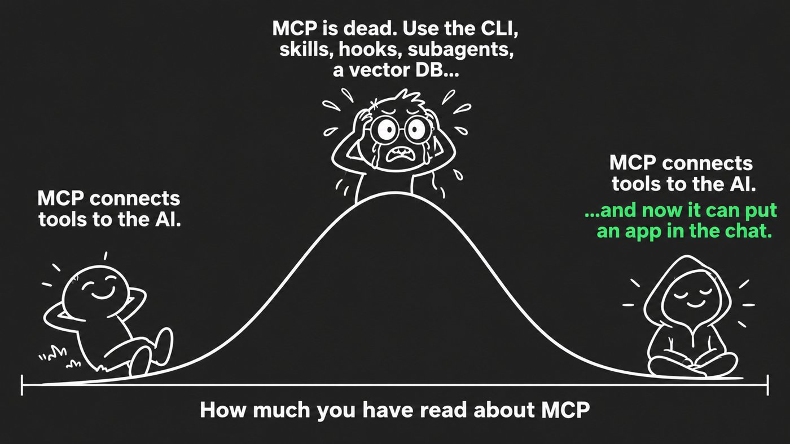

# Day 1: Is MCP dead?

No code today. Read both sides, try a real MCP server inside Claude, and get your laptop ready for tomorrow.



## The case against MCP

- **"MCP is dead. Long live the CLI"**, Eric Holmes, 28 February 2026. Models already know command-line tools like git, docker and kubectl, so wrapping them in MCP adds work for nothing. He also lists real pain: local servers that fail to start, a separate sign-in for every tool, and permissions you can only switch on or off per tool.
  [Read it](https://ejholmes.github.io/2026/02/28/mcp-is-dead-long-live-the-cli.html)
- **Perplexity**, March 2026. Its CTO reportedly told their developer conference they are moving their own agents from MCP to plain APIs and CLIs. We only found this in second-hand write-ups, so treat the details as reported, not quoted.
  [One write-up](https://www.agent-engineering.dev/article/why-perplexity-is-stepping-back-from-the-model-context-protocol-mcp-internally)
- **Anthropic**, November 2025. Loading every tool's description into the conversation up front makes an agent slower and more expensive. Their example went from 150,000 tokens to 2,000 by loading tools only when needed.
  [Code execution with MCP](https://www.anthropic.com/engineering/code-execution-with-mcp)

## The case for it

- Holmes himself: *"If a tool genuinely has no CLI equivalent, MCP might be the right call."*
- A command line can't show you anything. **MCP Apps** can: a tool opens a real interface inside the chat. They became an official part of MCP on 26 January 2026, and work in Claude (web and desktop), ChatGPT, VS Code and Goose.
  [The announcement](https://blog.modelcontextprotocol.io/posts/2026-01-26-mcp-apps/)
- Asana, Figma, Slack and Canva use them to open parts of their apps right inside Claude.
  [Claude's post](https://claude.com/blog/interactive-tools-in-claude)
- OpenClaw, one of the tools held up as not needing MCP, can itself run as an MCP server (`openclaw mcp serve`).
  [OpenClaw docs](https://docs.openclaw.ai/cli/mcp)

**Our take:** MCP isn't dead, it's narrower. A developer with a terminal is often fine with a CLI. When the tool lives inside a chat, is used by people who never open a terminal, or needs a screen that you and the AI share, that's MCP's job.

## Why an MCP App and not a web page?

A chart on a CSV doesn't need MCP. An MCP App earns its place when:

- **Claude reads the data and acts on it.** Ask "which product should I look at first?" and Claude answers from the chart next to it.
- **Your clicks reach Claude.** Press a button and the app tells Claude what you decided, so it can carry on.
- **It sits next to your other connectors.** One request can use your app and your email or calendar.
- **There's no separate site** to host or log in to.

That's the pattern for the rest of the week: **Claude suggests, you decide in the app.**

## Today's task (about 15 minutes)

1. **Try a real MCP server in Claude.** In Claude, open Customize → Connectors → Add custom connector, and paste:

   ```
   https://shop-data-mcp.empty-dream-9630.workers.dev/mcp
   ```

   It's the fictional shop from our Build Your First MCP workshop. Ask: *"Which Lighting product had the most returns in 2026-Q3?"* You'll get a text answer. Tomorrow we turn it into a chart.

   Free accounts can add one custom connector. Remove this one before Day 4, when you add your own.

2. **Get ready for tomorrow.** Install [Node.js](https://nodejs.org) 20 or newer and [git](https://git-scm.com/downloads). Then check in a terminal:

   ```bash
   node -v   # v20 or higher
   git --version
   ```

3. **Comment in the challenge thread:** what would you want as an app inside Claude? Something you check every week.

Tomorrow: [Day 2, your first MCP App](../day-2/).
