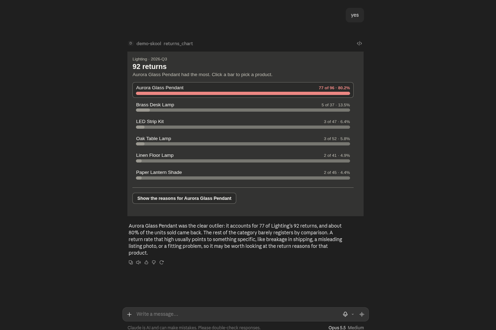
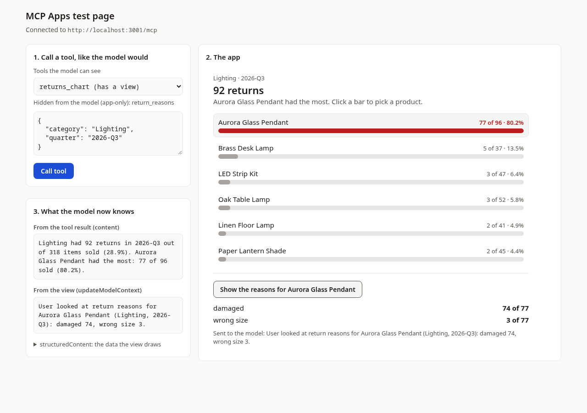

# Day 2: Build your first MCP App

**You're done when:** you've called `returns_chart` on the test page, seen the chart, clicked **Show the reasons**,
and watched the "What the model now knows" panel change.

An MCP App is a normal MCP tool with one extra: its result can open a small interactive page (a "view") right
inside the chat, in Claude or ChatGPT. Today you run one on demo data and see every part of it work on your own
laptop. No API key, no account, nothing to pay for.

The data is the Northwind Home shop from the Build Your First MCP workshop. The story is the same: in 2026-Q3,
Lighting had 92 returns, and the Aurora Glass Pendant was 77 of them.

## First, see it in Claude (5 minutes)

We host a copy of today's app. In Claude, go to **Customize → Connectors → Add custom connector** and paste:

```
https://mcp-apps-day-2.empty-dream-9630.workers.dev/mcp
```

On a Free account you get one custom connector, so remove yesterday's shop connector first. Then start a new
chat and ask: *"Which Lighting product had the most returns in 2026-Q3? Show me the chart."*



That's the app you're about to run yourself. Below, you run the same code on your laptop and see how each part
works.



## Before you start

- **Node.js 20.19 or newer.** Check with `node --version`. If it's older, or you don't have it, install the LTS
  version from [nodejs.org](https://nodejs.org/).
- **git.** Check with `git --version`.

You don't need Python or uv today.

## Run it

```bash
git clone https://github.com/akshika47/AI-Internship.git
cd AI-Internship/mcp-apps-challenge/day-2
npm install
npm start
```

Already cloned it for an earlier challenge? Run `git pull` in the `AI-Internship` folder instead of cloning.

`npm install` takes about 30 seconds the first time. `npm start` builds the view, then prints:

```
  MCP server   http://localhost:3001/mcp
  Test page    http://localhost:8080   <- open this

  Press Ctrl+C to stop.
```

Then:

1. Open **http://localhost:8080** in your browser.
2. Leave the input as it is (`Lighting`, `2026-Q3`) and click **Call tool**.
3. The chart appears. Click a bar to pick a product, then click **Show the reasons for …**.
4. Look at **What the model now knows**. It now has two lines:

```
From the tool result (content)
Lighting had 92 returns in 2026-Q3 out of 318 items sold (28.9%). Aurora Glass Pendant had the most: 77 of 96 sold (80.2%).

From the view (updateModelContext)
User looked at return reasons for Aurora Glass Pendant (Lighting, 2026-Q3): damaged 74, wrong size 3.
```

Try other inputs too: `{"category": "Kitchen", "quarter": "2026-Q2"}`, or a wrong one like
`{"category": "Garden"}` to see the error the model would get.

## What each file does

| File | What it does |
|---|---|
| `src/returns.ts` | The numbers: reads the CSV, counts returns per product, finds the reasons. No MCP in here |
| `src/app.ts` | The MCP server: the `returns_chart` tool, the app-only `return_reasons` tool, and the view resource |
| `src/server.ts` | Runs that server on your laptop at `localhost:3001/mcp` |
| `worker/` | Runs the same server on Cloudflare Workers, so Claude can reach it from the internet |
| `view/index.html`, `view/main.ts` | The view: the bar chart and the button. Built into one HTML file in `dist/view/` |
| `host/` | The test page: a tiny stand-in for Claude or ChatGPT, so you can test without them |
| `start.ts` | What `npm start` runs: the server on port 3001 and the test page on 8080 |
| `data/orders.csv` | The demo data. Tomorrow you swap in your own |
| `tests/` | Free tests: the numbers, and the server's answers over real HTTP |
| `scripts/` | `e2e.ts` clicks through the test page in a browser; `check-remote.ts` checks a deployed server |

## How it works

1. **The model calls the tool.** `returns_chart` is listed with `_meta.ui.resourceUri: "ui://returns/view.html"`.
   That line is what makes it an app: it tells the host which view belongs to this tool.
2. **The result has two parts.** `content` is the sentence the model reads. It makes sense on its own, so the
   tool still works in an app that can't show views. `structuredContent` is the data the view draws.
3. **The host shows the view in a sandbox.** It reads `ui://returns/view.html` from your server and puts it in
   an iframe on a different origin (port 8081 here), so the view can't touch the page around it. Then it hands
   the view the tool result, and `app.ontoolresult` draws the bars.
4. **You click, the view acts.** The button calls `app.callServerTool("return_reasons", …)`, which goes through
   the host to your server. Then `app.updateModelContext(…)` tells the model what you looked at. The model
   reads that on your next message; it doesn't start a reply by itself.

## Two traps

- **Build the view before the server serves it.** The server sends `dist/view/index.html`, which only exists
  after `npm run build`. `npm start` builds first. If you run the server some other way and the view is
  blank, that's why: the server answers "The view isn't built yet".
- **App-only is not a security boundary.** `return_reasons` has `visibility: ["app"]`, so hosts hide it from
  the model. But it's still in the server's tool list, and anyone who can reach your server can call it. Never
  put something behind "app-only" that you wouldn't let any caller do. Both tools here only read.

## Tests

```bash
npm test             # builds, then runs the free tests (no browser)
npm run typecheck    # TypeScript checks every file
```

```
 Test Files  2 passed (2)
      Tests  24 passed (24)
```

`npm run test:e2e` opens the test page in a real browser, clicks through it and saves the screenshots in
`docs/`. It needs Playwright, which `npm install` leaves out because it's big:
`npm install --no-save playwright-core && npx playwright-core install chromium`.

GitHub runs the build, the type check and the free tests on Node 20 and 22 for every pull request: see
`.github/workflows/mcp-apps-challenge-tests.yml` at the top of the repo.

## Stuck?

| You see | Try this |
|---|---|
| `Port 3001 is already in use` (or 8080) | `npm start` is already running in another terminal. Stop it with Ctrl+C, or just use that one |
| `npm install` warns `EBADENGINE`, or `npm start` says "Vite requires Node.js version 20.19+ or 22.12+" | Your Node is too old. Install the LTS from [nodejs.org](https://nodejs.org/), open a new terminal, run `npm install` again |
| The chart area stays blank | Make sure you opened `http://localhost:8080`, not a `127.0.0.1` address. Then stop and run `npm start` again (it rebuilds the view) |
| "Can't reach the MCP server" on the test page | The terminal running `npm start` was closed or stopped. Start it again |
| Your browser shows "Not Acceptable" at `localhost:3001/mcp` | That's normal: the server only talks to MCP clients, not to a browser tab |

## Put your own copy online (optional)

You don't need this today. If you want your own public copy, it runs free on Cloudflare Workers:

```bash
npx -y wrangler@4.127.1 login          # once, opens your browser
npm run worker:deploy                   # builds the view, then deploys
npm run check:remote -- https://mcp-apps-day-2.<your-subdomain>.workers.dev/mcp
```

The last command calls both tools and reads the view, the same way Claude would. Then add the `/mcp` URL to
Claude as a custom connector. Everything it serves is public, so only deploy demo data or data you're happy to
share. The server only reads; there's nothing to change or delete.

## Tomorrow: your own data

On Day 3 you replace `data/orders.csv` with a CSV of your own and change `src/returns.ts` to count what matters
in it. The server, the view and the test page stay almost the same.

The test page is for building. To use your app inside Claude itself, Claude has to reach your server from the
internet, so it needs a public URL instead of `localhost`. That's Day 4.

## Further reading

- [MCP Apps overview](https://modelcontextprotocol.io/extensions/apps/overview) and the
  [`ext-apps` repo](https://github.com/modelcontextprotocol/ext-apps), with the spec and many examples.
- [Build Your First MCP](../../build-your-first-mcp/): the workshop this data comes from.
