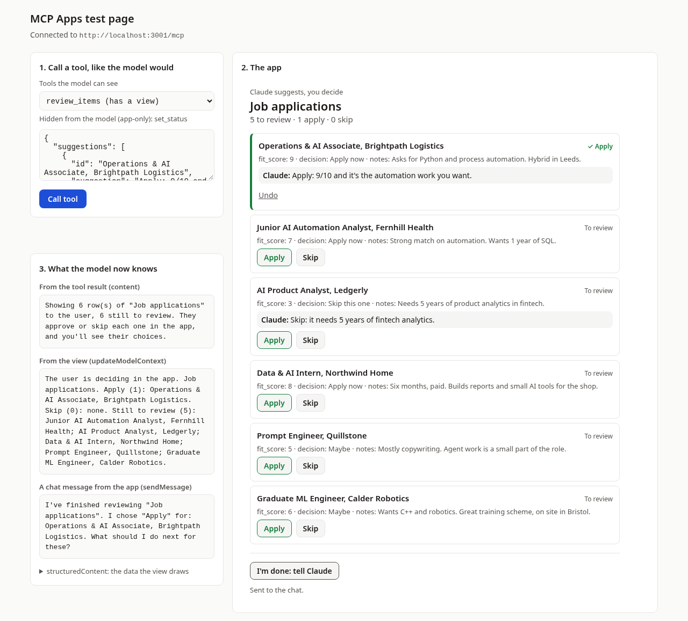

# Day 3: Claude suggests, you decide

**You're done when:** your own CSV is open in the app, with a suggestion from Claude on each row, and you've
approved or skipped at least one row and seen the change in your CSV.

Yesterday's app only showed you something. Today's app changes something, and that's where MCP Apps earn
their place: Claude reads your rows and suggests what to do with each one, but **you** make the call, with a
button, in the app. Claude never approves anything on its own.

Three examples come with it. All three use the same code. Only a small config file and the CSV change:

| Example | Your CSV | Claude suggests | Your buttons |
|---|---|---|---|
| `examples/job-board` | Job ads you've found | Apply or skip, and why | Apply · Skip |
| `examples/weekly-numbers` | This week's numbers | Which ones need a follow-up | Follow up · It's fine |
| `examples/todo-from-notes` | Meeting notes | A to-do for each note, or nothing | Add to-do · No to-do |



## Before you start

The same as Day 2: **Node.js 20.19 or newer** (`node --version`) and **git** (`git --version`).

## Run the job board

```bash
cd AI-Internship
git pull
cd mcp-apps-challenge/day-3
npm install
npm start
```

New to the repo? Clone it first: `git clone https://github.com/akshika47/AI-Internship.git`.

Open **http://localhost:8080**, then:

1. In **Tools the model can see**, pick `review_items`. The input box fills with two sample suggestions, the kind
   Claude would send. Click **Call tool**.
2. The board appears. Click **Apply** on one card and **Skip** on another.
3. Look at **What the model now knows**: it lists what you decided. Open
   `examples/job-board/applications.csv`: there's a new `status` column with `approved` and `skipped` in it.
4. Click **I'm done: tell Claude**. In Claude, that puts a message in the chat box for you, and Claude replies once
   you press Send.

To run another example: `npm start examples/weekly-numbers`.

## Make it yours

1. Copy an example: `cp -r examples/job-board my-app` (on Windows: copy the folder in Explorer).
2. Put your CSV in `my-app/` and open `my-app/app.config.json`:

```json
{
  "title": "Job applications",
  "csv": "applications.csv",
  "id": "role",
  "details": ["fit_score", "decision", "notes"],
  "approve": "Apply",
  "skip": "Skip",
  "ask": "For each role, suggest apply or skip in one short sentence, using the fit score and the notes.",
  "sample": []
}
```

| Field | What it is |
|---|---|
| `title` | The app's name, shown at the top |
| `csv` | Your file. It must be inside the app's folder |
| `id` | A column that's different on every row: a name, a title, a number |
| `details` | Up to 6 more columns to show on each card |
| `approve`, `skip` | The two button labels |
| `ask` | What Claude should suggest for each row. This goes into the tool's description, so Claude reads it |
| `sample` | Optional: example suggestions, so the test page has something to show |

3. Run `npm start my-app`. If something's wrong, it tells you before anything starts: a missing column, an
   id that repeats, a CSV outside the folder.

Your data goes in a column called `status` (change it with `"status": "..."` in the config). It's added the first
time you click a button. A copy of your original file is saved next to it as `.bak` before the first change.

Did the Agent SDK challenge? Your job-fit agent wrote `applications.csv` with `role`, `fit_score` and `decision`
columns. Copy it into `my-app/` and set `"details": ["fit_score", "decision"]` (it has no `notes` column). If you
scored the same role twice, delete one of the two rows first: the id must be different on every row.

## How it works

1. **Claude reads your rows.** `list_items` returns them as text, one line each, and ends with your `ask`.
2. **Claude suggests, the app shows.** `review_items` takes one suggestion per row id. Its result opens the view
   (`_meta.ui.resourceUri`), and the view draws a card per row with Claude's suggestion on it.
3. **You decide.** A button calls `set_status`, the only tool that writes. Then `app.updateModelContext(...)`
   tells Claude what you decided. Claude reads that on your next message.
4. **You hand back.** **I'm done** calls `app.sendMessage(...)`, which hands the chat a message from you. Unlike
   `updateModelContext`, it gets a reply. Claude.ai puts it in the message box with a warning and waits for you to
   press Send: even a message from your own app needs your OK.

## The write is the part to get right

`set_status` changes your file, so it's built to do as little as possible:

- **It's hidden from the model** (`visibility: ["app"]`), so only a click can call it. But hidden isn't locked:
  anyone who can reach your server can call any tool on it. So it also checks everything itself.
- **It accepts almost nothing:** a row id that must already exist, and one of `to review`, `approved`, `skipped`.
  It can't add rows, delete rows, or change any other cell.
- **The CSV must be inside the app's folder.** A config can't point it at another file on your laptop.
- **It keeps a backup** (`.bak`) before the first change, and writes to a temporary file first, so a crash
  can't leave half a CSV.
- **The view never uses `innerHTML` with your data**, so a cell with HTML in it shows as text and can't run.

## Tests

```bash
npm test             # builds, then runs the free tests (no browser)
npm run typecheck    # TypeScript checks every file
```

```
 Test Files  2 passed (2)
      Tests  20 passed (20)
```

`npm run test:e2e` clicks through the board in a real browser, on a copy of the job board, and checks the CSV
after each click. It needs Playwright: `npm install --no-save playwright-core && npx playwright-core install chromium`.

## Stuck?

| You see | Try this |
|---|---|
| `There's no app.config.json in my-app` | Run `npm start my-app` from the `day-3` folder, and check the folder name |
| `has no column called "..."` | The message lists your CSV's real columns. Copy the name exactly, including capitals |
| `"..." appears twice in the "id" column` | Pick a column that's different on every row, or add one (a row number works) |
| `Port 3001 is already in use` | Yesterday's `npm start` is still running. Stop it with Ctrl+C |
| My CSV opens in Excel with a new `status` column | That's the app's work. Your original is in the `.bak` file next to it |

## Tomorrow

Today Claude's suggestions come from the test page's sample. On Day 4 you put this app in Claude itself, through
a tunnel, so Claude reads your real rows and writes the suggestions. Then you check it's safe, and show us.
